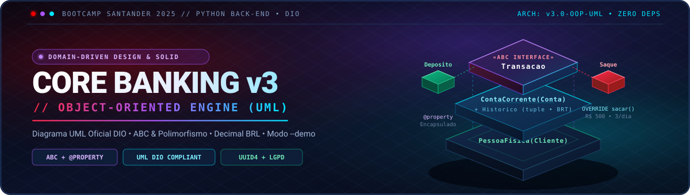
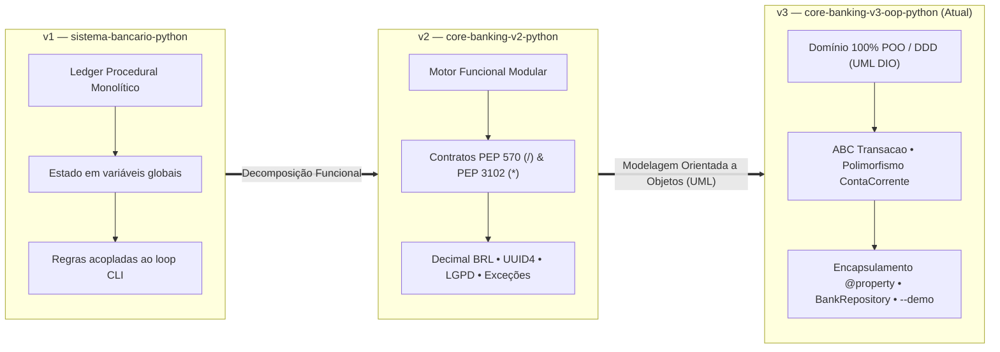
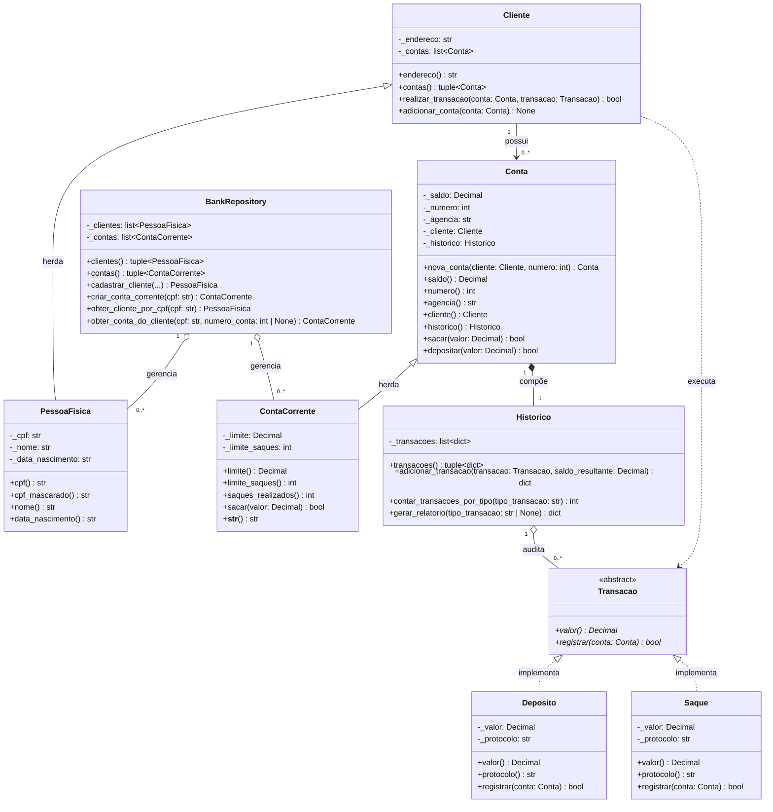

<div align="center">



<br/>

[](https://www.python.org/)
[](#diagrama-de-classes-uml)
[](#diagrama-de-classes-uml)
[](#arquitetura-das-classes-e-modulos)
[](#execucao-modo-demo-e-testes)
[](https://www.dio.me/)

**Terceiro marco público da trilogia arquitetural de Core Banking para o desafio _"Modelando o Sistema Bancário em POO com Python"_ (Bootcamp Santander 2025 Python Back-End — DIO) — engenharia reversa 100% fiel ao diagrama UML oficial da DIO, com domínio blindado por ABC, `@property`, polimorfismo, precisão `Decimal` (`ROUND_HALF_UP`), protocolos `UUID4`, privacidade LGPD e Modo Tour Interativo (`--demo`).**

</div>

---

## Evolução da Trilogia Arquitetural (`v1` → `v2` → `v3`)

Este repositório culmina a jornada evolutiva de arquitetura de software aplicada a sistemas bancários em Python puro (stdlib only):



---

## Diagrama de Classes UML

Engenharia reversa rigorosa do modelo UML oficial da DIO, preservando relacionamentos de realização (`<|..`), herança (`<|--`), composição (`*--`) e associação (`-->`), com atributos privados protegidos por `@property`:



---

## Os 4 Pilares da POO Aplicados na Prática

| Pilar da POO | Implementação no Domínio (`src/models/`) | Garantia Arquitetural |
| :--- | :--- | :--- |
| **Abstração** | `Transacao(ABC)` com `@property @abstractmethod def valor` e `@abstractmethod def registrar(self, conta)` | Impede instanciação direta (`TypeError`) e obriga toda nova operação financeira a cumprir o contrato de registro auditável. |
| **Encapsulamento** | Atributos protegidos (`_saldo`, `_transacoes`, `_contas`, `_cpf`, `_limite`) expostos apenas via `@property` read-only e tuplas imutáveis com cópia defensiva | Bloqueia sobrescrita indevida (`conta.saldo = ...` lança `AttributeError`) e protege o `Historico` contra mutação externa. |
| **Herança** | `PessoaFisica(Cliente)`, `ContaCorrente(Conta)`, `Deposito(Transacao)`, `Saque(Transacao)` e árvore `BankingOOPError` | Reaproveita invariantes do núcleo bancário sem duplicação de código e especializa responsabilidades com clareza semântica. |
| **Polimorfismo** | `Cliente.realizar_transacao(conta, transacao)` despacha dinamicamente para `Deposito`/`Saque`; `ContaCorrente.sacar(valor)` sobrescreve `Conta.sacar(valor)` | Aplica teto de `R$ 500,00` e cota de `3 saques` contabilizados diretamente na instância `Historico`, delegando débito final via `super().sacar()`. |

---

## Arquitetura das Classes e Módulos

```text
core-banking-v3-oop-python/
├── assets/
│   └── banner.svg                         # Vitrine vetorial 3D isométrica cyber-dark
├── src/
│   ├── __init__.py                        # API pública consolidada do pacote
│   ├── exceptions.py                      # Hierarquia tipada BankingOOPError (8 exceções)
│   ├── formatters.py                      # Decimal ROUND_HALF_UP, BRL, LGPD, relógio BRT, UUID4
│   ├── repository.py                      # BankRepository (unicidade CPF, contas sequenciais)
│   ├── cli.py                             # Terminal Unicode blindado + Modo Tour (--demo)
│   └── models/
│       ├── __init__.py                    # Exportação das 8 entidades do diagrama UML
│       ├── transacao.py                   # Transacao (ABC), Deposito e Saque
│       ├── historico.py                   # Historico imutável (UTC-3 BRT) + gerar_relatorio()
│       ├── cliente.py                     # Cliente e PessoaFisica (CPF sanitizado + LGPD)
│       └── conta.py                       # Conta (fábrica nova_conta) e ContaCorrente
├── tests/
│   ├── __init__.py
│   └── test_core_banking_v3_oop.py        # Suíte unittest (21 testes: ABC, POO, Decimal, LGPD, CLI)
├── main.py                                # Entrypoint com suporte a CLI e flag `--demo`
├── .gitignore
└── README.md
```

| Classe / Módulo | Camada | Responsabilidade Principal |
| :--- | :---: | :--- |
| **`Transacao` (`ABC`)** | `models/transacao.py` | Interface abstrata que define o contrato `valor` e `registrar(conta)`. |
| **`Deposito` & `Saque`** | `models/transacao.py` | Encapsulam valor `Decimal` (`ROUND_HALF_UP`), geram protocolo `TX-XXXXXXXX` (`UUID4`) e só gravam no `Historico` quando aprovadas. |
| **`Historico`** | `models/historico.py` | Trilha imutável (`tuple`) com timestamp de Brasília (`UTC-3`), saldo resultante e métricas consolidadas via `gerar_relatorio(tipo_transacao=None)`. |
| **`Cliente` & `PessoaFisica`** | `models/cliente.py` | Gerenciam endereço, lista imutável de contas, execução polimórfica de transações, sanitização de CPF (11 dígitos) e máscara LGPD (`***.XXX.XXX-**`). |
| **`Conta` & `ContaCorrente`** | `models/conta.py` | Fábrica `@classmethod nova_conta`, proteção de saldo via `@property`, sobrescrita polimórfica de `sacar` (teto `R$ 500,00` e `3` saques no `Historico`) e `__str__` com máscara LGPD. |
| **`BankRepository`** | `repository.py` | Repositório em memória com unicidade de CPF (independente de pontuação) e numeração sequencial automática na agência `0001`. |
| **`BankingOOPError` (+7 subclasses)** | `exceptions.py` | `CPFInvalidoOuDuplicadoError`, `TitularNaoEncontradoError`, `ContaNaoEncontradaError`, `ValorInvalidoError`, `SaldoInsuficienteError`, `LimiteSaqueExcedidoError`, `LimiteDiarioSaquesError`. |

---

## Execução, Modo `--demo` e Testes

<details open>
<summary><strong>1-Clique para Avaliadores & Recrutadores — Modo Tour Interativo (<code>--demo</code>)</strong></summary>

Sem nenhuma dependência externa (100% Python Standard Library 3.10+). Execute o roteiro guiado automatizado em um único comando para ver **todos os pilares POO, regras bancárias, precisão `Decimal`, bloqueios de limite, máscara LGPD e extrato auditado** funcionando ao vivo:

```bash
# 1. Clone o repositório
git clone https://github.com/lcszero44-cell/core-banking-v3-oop-python.git
cd core-banking-v3-oop-python

# 2. Execute o Modo Tour Interativo / Auto-Testes Guiados
python main.py --demo
```

O comando `--demo` executa automaticamente **7 passos auditados em ambiente isolado**:
1. Cadastro de `PessoaFisica` + sanitização de CPF + bloqueio de CPF duplicado (`CPFInvalidoOuDuplicadoError`).
2. Abertura de múltiplas contas correntes via `ContaCorrente.nova_conta` + listagem tabular LGPD.
3. Depósitos polimórficos via `Cliente.realizar_transacao` + prova `Decimal` (`0.10 + 0.20 == 0.30` e `ROUND_HALF_UP` em `10.005 -> 10.01`) + protocolos `TX-XXXXXXXX`.
4. Saque válido + bloqueio polimórfico por teto de `R$ 500,00` (`LimiteSaqueExcedidoError`) sem poluir o `Historico`.
5. Bloqueio por cota de `3 saques` (`LimiteDiarioSaquesError`) + proteção de saldo insuficiente (`SaldoInsuficienteError`).
6. Verificação em runtime de `Transacao()` (`TypeError`), `conta.saldo = ...` (`AttributeError`) e imutabilidade de `historico.transacoes` (`tuple`).
7. Emissão do extrato bancário consolidado com timestamps de Brasília (`UTC-3`) e métricas de `Historico.gerar_relatorio()`.

</details>

<details>
<summary><strong>Terminal Interativo Completo (CLI Blindada)</strong></summary>

```bash
python main.py
```

**Comandos disponíveis no terminal:**
- `[d]` **Depositar** — crédito `Decimal` com emissão de protocolo `UUID4`
- `[s]` **Sacar** — validação polimórfica de cota (3 saques), teto (`R$ 500,00`) e saldo
- `[e]` **Extrato Detalhado** — filtro opcional (`Todas`, `Deposito`, `Saque`) + métricas consolidadas
- `[nu]` **Novo Cliente PF** — cadastro validado com sanitização de CPF e máscara LGPD
- `[nc]` **Nova Conta Corrente** — abertura sequencial na agência `0001` (suporta múltiplas contas por titular)
- `[lc]` **Listar Contas** — tabela Unicode box-drawing com CPF mascarado (`***.XXX.XXX-**`)
- `[demo]` **Modo Tour** — executa a demonstração completa sem alterar as contas reais da sessão
- `[q]` **Sair** — encerramento seguro (blindado também contra `EOF` e `Ctrl+C`)

</details>

<details>
<summary><strong>Suíte de Testes Unitários (Modo Estrito <code>-W error</code>)</strong></summary>

Execute todos os 21 testes tratando qualquer warning do interpretador como falha:

```bash
python -W error -m unittest discover -s tests -v
```

**Cenários cobertos:**
- Contratos abstratos (`inspect.isabstract(Transacao)`, `TypeError` em instanciação direta ou subclasse incompleta).
- Herança oficial do UML (`PessoaFisica < Cliente`, `ContaCorrente < Conta`, `Deposito/Saque < Transacao`, árvore `BankingOOPError`).
- Encapsulamento via `@property` (bloqueio de escrita em `saldo`, `historico.transacoes`, `cliente.contas`, `cpf`, `limite` e cópias defensivas).
- Polimorfismo em `ContaCorrente.sacar` vs `Conta.sacar`, `Cliente.realizar_transacao` e integridade do `Historico` em operações rejeitadas.
- Precisão `Decimal` (`ROUND_HALF_UP`), protocolos `TX-XXXXXXXX`, timestamps `UTC-3` (BRT), máscara LGPD e execução de `python main.py --demo`.

</details>

---

<div align="center">
<sub>Desenvolvido para o desafio <strong>Modelando o Sistema Bancário em POO com Python</strong> — Bootcamp Santander 2025 Python Back-End (DIO).</sub>
</div>
